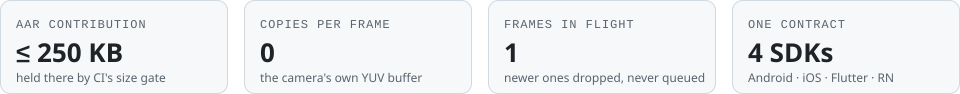

# kamera, the Swift package


**The Swift Package Manager distribution of kamera, the camera engine behind the Smile ID SDKs.**
This repository holds the `Package.swift` manifest, and each release carries the xcframeworks it
points at.

kamera drives AVFoundation behind one `KameraSession`: preview, a frame stream an analyzer can
trust, and real stills, labelled with what actually produced them.

<picture>
  <source media="(prefers-color-scheme: dark)" srcset="assets/readme/hero-dark.svg">
  
</picture>

<p align="center"><sub>One frame in flight. A frame that arrives while the analyzer holds one is dropped, never queued, and one shot while focus settles is skipped. <code>close()</code> opens the gate. Only results cross the bridge.</sub></p>

<picture>
  <source media="(prefers-color-scheme: dark)" srcset="assets/readme/facts-dark.svg">
  
</picture>

## Install

In Xcode, choose **File → Add Package Dependencies…** and enter
`https://github.com/smileidentity/kamera-spm`. Or add it to your own `Package.swift`:

```swift
dependencies: [
    .package(url: "https://github.com/smileidentity/kamera-spm", exact: "1.1.0")
]
```

Then add the `Kamera` product to your target, and `import Kamera`.

Pin it `exact`. In an app that also uses a Smile ID SDK (iOS, Flutter or React Native), pin the
version that SDK pins, or leave kamera-spm out and let the SDK bring it in: the SDKs pin kamera-spm
exactly, and SwiftPM resolves one version, so any other pin fails to resolve.

> [!TIP]
> Snapshots are tagged too, so one can be pinned `exact` the same way, for example
> `exact: "1.1.1-SNAPSHOT.19"`, or followed on the `snapshot` branch:
> `.package(url: "https://github.com/smileidentity/kamera-spm", branch: "snapshot")`.
> [Releases](https://github.com/smileidentity/kamera-spm/releases) lists them all.

## Products

| Product | Use it for |
|---|---|
| `Kamera` | The camera engine: session, preview, frame stream and capture. Start here |
| `KameraVision` | The Apple Vision analyzer adapter. Separate, so a consumer without ML pays nothing for it |
| `KameraTesting` | The replay test kit, which drives recorded fixtures through the real pipeline. Test targets and sample apps only, never a release graph |

Binary targets carry no dependency edges of their own, so `KameraVision` and `KameraTesting` each
bring `Kamera` in through their product.

| iOS | Swift tools | Built with | Dependencies |
|---|---|---|---|
| 15.0 or later | 6.0 or later | Xcode 26.4 | Apple's frameworks only: no third-party code |

## One version everywhere

kamera ships every platform at one version, so a version here is the same release on Android,
Flutter and React Native.

| iOS | Android | Flutter | React Native |
|---|---|---|---|
| this package | `com.usesmileid:kamera` | `usesmileid_kamera` | `@smileid/kamera` |

| Branch | Holds |
|---|---|
| `main` | production releases |
| `snapshot` | snapshots and betas |

## Documentation

Integration guides and API documentation are in the
[Smile ID documentation](https://docs.usesmileid.com).

## License

MIT. See [LICENSE](LICENSE).
