# kamera, the Swift package

The Swift Package Manager distribution of **kamera**, the camera engine behind the Smile ID SDKs.

<picture>
  <source media="(prefers-color-scheme: dark)" srcset="assets/readme/spm-install-dark.svg">
  
</picture>

## Install

```swift
.package(url: "https://github.com/smileidentity/kamera-spm", exact: "1.1.0")
```

Pin it exactly. An app that also uses a Smile ID SDK takes the version that SDK pins, or leaves
kamera-spm out and lets the SDK bring it in.

| Product | For |
|---|---|
| `Kamera` | the camera engine. Start here |
| `KameraVision` | the Apple Vision analyzer, optional |
| `KameraTesting` | test targets and sample apps only |

iOS 15 or later · Swift tools 6.0 · built with Xcode 26.4 · no third-party dependencies

## Releases

[Releases](https://github.com/smileidentity/kamera-spm/releases) lists every version with its
xcframeworks and their SHA-256 sums. A snapshot, `x.y.z-SNAPSHOT.N`, is for testing only, and the
`snapshot` branch follows the newest.

MIT licensed. See [LICENSE](LICENSE).
